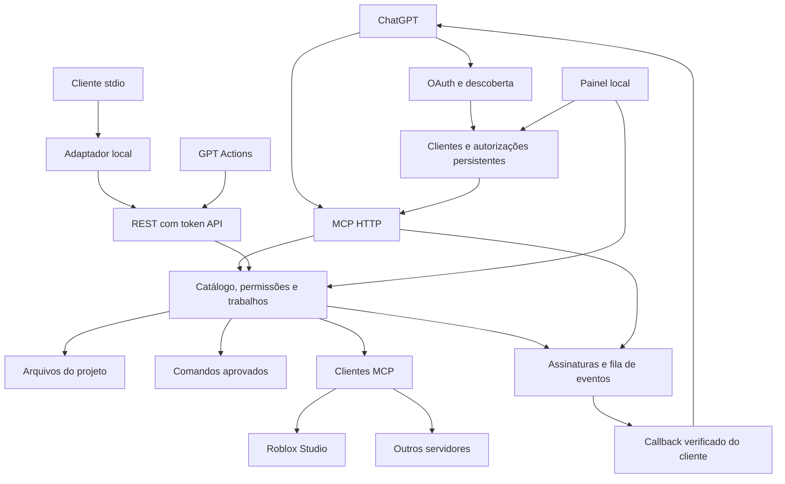

# Arquitetura da Ponte MCP 0.4.0

## Componentes

O mesmo processo mantém o provedor OAuth, os clientes externos e os trabalhos. As fachadas MCP e REST não executam ferramentas diretamente: ambas passam pelo `JobManager`. O consentimento OAuth autoriza uma conexão a solicitar ferramentas; a política de trabalhos determina quais solicitações exigem revisão local antes de executar.

## Decisões

**Servidor local com painel web.** Atende Windows sem depender de Electron ou empacotamento nativo. O pacote também é executável em Linux/macOS. O frontend não depende de serviços externos nem envia telemetria.

**Dois listeners.** Permite encaminhar ferramentas por HTTPS sem expor rotas administrativas. Tokens e origens também são verificados independentemente.

**OAuth na fachada MCP.** A API da porta 4318 contém descoberta, registro de clientes, autorização, consentimento no navegador, troca de tokens, renovação, revogação e `/mcp`. O painel da porta 4317 continua sendo o local onde o proprietário aprova a conexão. O servidor usa authorization code com PKCE `S256` e scope `ponte:tools`. Cada ferramenta declara sua política OAuth e o espelho compatível em `_meta.securitySchemes`.

**Compatibilidade com instalações existentes.** `/mcp` aceita access tokens OAuth e o token API legado. A REST `/v1/*` mantém a autenticação por token API, usada por Actions e pelo adaptador stdio. Tokens OAuth não autorizam rotas administrativas nem substituem a autenticação da REST.

**Transporte MCP sem estado de sessão.** Cada POST autenticado em `/mcp` passa pela escolha de protocolo. Pedidos legados usam uma instância de servidor e transporte Streamable HTTP do SDK v1; pedidos com protocolo `2026-07-28` usam o adaptador `src/mcp/modern.ts`, com descoberta por `server/discover` e metadados por requisição. Ambos devolvem JSON. Não há sessão persistente do transporte nem canal SSE mantido por GET; esse método retorna 405 depois da autenticação. O estado de autorizações, assinaturas e trabalhos pertence à aplicação, não à sessão de transporte.

**Trabalhos assíncronos com espera limitada.** `callGateway` aguarda até 25 segundos enquanto uma chamada de ferramenta está `queued` ou `running`. Um `pending_approval` inicial retorna imediatamente. `bridge_job` aceita `waitMs` inteiro de 0 a 25000, padrão 0, e pode esperar por aprovação e execução do mesmo trabalho (`pending_approval`, `queued` ou `running`). Ao vencer o prazo, retorna o estado atual e mantém o `jobId` consultável. A espera ocorre durante uma chamada do turno ativo; não reabre uma conversa encerrada.

**SDK oficial e descoberta dinâmica.** Upstreams implementam protocolos e schemas diferentes. O hub usa o SDK MCP para negociação e transportes, pagina catálogos, cria nomes únicos e preserva blocos de conteúdo. Não assume os argumentos das ferramentas Roblox.

**SDK v1 preservado e adaptador moderno delimitado.** `@modelcontextprotocol/sdk` 1.32.1 continua responsável por clientes legados, stdio e upstreams. O adaptador HTTP implementa `server/discover`, `tools/list`, `tools/call` e os três métodos `events/*` usados pela integração de Events. Valida versão, envelope JSON-RPC, metadados e espelhos de cabeçalhos; a descoberta anuncia somente `tools` e `events`. Todos os resultados modernos incluem `resultType: "complete"`. Resources, prompts, sampling, tarefas do protocolo e transporte moderno por stdio não são anunciados. Essa mudança não é uma migração completa das dependências para o SDK v2.

**API independente de provedor.** Nenhum SDK de modelo é necessário. O cliente de chat fornece o modelo e a política de conversação. O OpenAPI mantém somente cinco Actions e descobre schemas por catálogo, reduzindo a necessidade de reinstalar a integração a cada novo servidor conectado.

## Política de aprovação

`approvalMode` é persistido em `config.json`. O padrão continua sendo `mutations`: leituras podem executar diretamente, enquanto alterações e comandos aguardam revisão. `all` exige revisão de todas as ferramentas. `automatic` aprova as chamadas futuras e reconcilia a fila, liberando solicitações pendentes ainda válidas. A política vale para ferramentas locais, upstreams MCP, chamadas do painel e todos os clientes autorizados.

A seleção fica em **Visão geral → Você no controle → Política de aprovação**. Mudar para **Aprovar automaticamente todas** não altera permissões de projeto, listas permitidas, validação de argumentos ou verificações de hash. A assinatura da ferramenta é revalidada; solicitações obsoletas são recusadas. Novas conexões OAuth continuam dependendo da decisão local.

Ao selecionar uma política que exija revisão, trabalhos aprovados automaticamente ainda em `queued` voltam para `pending_approval` quando necessário. Trabalhos com aprovação manual e trabalhos já iniciados não são retirados da execução por essa mudança. A pausa impede novas solicitações e a partida da fila.

O status público inclui `approvalMode`. Trabalhos aprovados registram `approval: "manual"` ou `approval: "automatic"`; o campo aparece nas respostas MCP, nos detalhes do painel e na auditoria. Leituras liberadas pela política `mutations` podem não ter esse campo.

## Interfaces internas

`ToolDefinition` associa metadados MCP, risco, origem, fingerprint, preview opcional e execução cancelável. Ferramentas locais e externas implementam o mesmo contrato.

`ConfigStore` valida e persiste o estado administrativo. `JobManager` copia argumentos, valida JSON Schema, controla fila/aprovação/idempotência, identifica a conexão que criou o trabalho e registra transições. `McpHub` mantém clientes por conexão e descarta definições obsoletas. `EventService` gerencia assinaturas, cópias dos trabalhos acompanhados e uma fila de entrega persistente. O módulo `events/webhook.ts` verifica destinos e assina e envia callbacks. `Application` reúne esses componentes e compõe as rotas.

## Fluxo de autorização

1. O cliente descobre o recurso `/mcp` e o servidor de autorização. A origem HTTPS configurada fornece o `issuer` exato, sem barra final; o recurso acrescenta `/mcp`.
2. O ChatGPT cadastra um cliente em `/register` por DCR. O registro persiste e aceita `none` ou `client_secret_post`.
3. `/authorize` valida cliente, redirect, recurso, scope e desafio PKCE. A página `/oauth/consent` mostra um código de verificação de oito caracteres e acompanha o pedido.
4. O proprietário encontra o mesmo código no painel local e aprova ou rejeita. O navegador retorna ao redirect registrado com `state` e `iss`; no sucesso, recebe também um código OAuth de uso único.
5. O cliente troca o código em `/token`, comprovando PKCE e os vínculos da autorização. As credenciais emitidas ficam vinculadas ao cliente e ao recurso.
6. Chamadas MCP apresentam o access token. A validação de credenciais antecede a execução; em seguida, as permissões de projeto e as regras de aprovação de trabalhos continuam sendo aplicadas.
7. A renovação rotaciona o refresh token, preservando o prazo absoluto da autorização. Revogação e detecção de reutilização invalidam a família de tokens correspondente.

A implementação anuncia suporte à identificação do emissor em respostas de autorização (RFC 9207). Redirects de sucesso e erro incluem o `iss` exato. Erros anteriores à validação de cliente e redirect são respondidos diretamente, sem redirecionar para um endereço não validado.

## Persistência e limites de identidade

O diretório de estado padrão é `.ponte` dentro da pasta de instalação. `--state-dir` ou `PONTE_STATE_DIR` permitem reutilizar um caminho absoluto, inclusive ao mover ou atualizar o programa. `config.json` guarda a configuração, incluindo a política de aprovação; `secrets.json`, os tokens locais; `oauth.json`, clientes e autorizações OAuth. Trabalhos comuns permanecem em memória, com auditoria de metadados e backups em disco. `events.json` acrescenta assinaturas, segredos de webhook, entregas e cópias dos trabalhos acompanhados, incluindo seus resultados e sem os argumentos de entrada.

Pedidos OAuth aguardam aprovação por 10 minutos. Códigos de autorização valem por 2 minutos, access tokens por até 1 hora e a autorização renovável tem prazo absoluto de 30 dias. A rotação do refresh token não reinicia esse prazo. O registro DCR e seu segredo não recebem expiração automática, para permitir sua reutilização após reinícios e novas autorizações. Pedidos pendentes e códigos ainda não trocados são voláteis; um reinício exige recomeçar esses fluxos.

A aplicação continua tendo **um único proprietário**. Conexões OAuth são revogáveis separadamente, mas compartilham o catálogo, os projetos autorizados e as políticas do painel. A leitura e o cancelamento de trabalhos por um cliente, tanto em memória quanto na recuperação de resultados arquivados, exigem a autorização OAuth ou identidade do token API que criou o trabalho. O painel administrativo mantém acesso a todos. Esse controle por trabalho não cria uma divisão dos projetos por usuário; isolamento entre proprietários exigiria instâncias e diretórios de estado separados ou uma arquitetura de autorização adicional.

## Eventos e continuidade

O evento `ponte.job.completed` exige `arguments.jobId`; não existe inscrição global para todos os trabalhos. O cliente cria a assinatura por `events/subscribe`, fornecendo callback HTTPS e segredo `whsec_`. A Ponte verifica o destino com um desafio assinado antes de ativar a assinatura. O próprio cliente determina qual conversa recebe o evento e como ela continua, conforme a [integração de MCP Events da OpenAI](https://developers.openai.com/plugins/build/mcp-events).

Uma assinatura só pode acompanhar trabalho criado pela mesma autorização OAuth ou identidade do token API. O ID da assinatura deriva da identidade autenticada, do callback, do evento e dos argumentos. Renovar a mesma assinatura preserva esse ID; alterações de segredo permitem uma sobreposição de assinaturas criptográficas por cinco minutos. A validade tem padrão e máximo de 24 horas por renovação. A autorização OAuth precisa continuar válida: revogação, vencimento ou mudança de emissor impedem novas entregas.

Ao aceitar a inscrição, o serviço registra uma cópia do trabalho e reserva espaço para seu resultado final. As transições terminais `succeeded`, `failed`, `rejected`, `cancelled` e `expired` geram um evento de metadados. A inscrição consulta novamente o trabalho depois de verificar o callback; assim, uma conclusão ocorrida durante a verificação também é enfileirada. Uma assinatura feita depois de o trabalho terminar recebe seu estado terminal atual, sem reprodução de um histórico de eventos.

O evento tem identidade estável nas tentativas de entrega. A tentativa é persistida antes do envio; falhas de conexão e respostas recusadas têm novas tentativas limitadas, enquanto HTTP 410/413 encerram a entrega daquele evento. Uma resposta 2xx registra o recebimento pelo cliente. Se o processo parar depois de o destinatário aceitar o evento e antes de persistir a confirmação, o envio pode se repetir: o cliente deve deduplicar por `eventId`.

Assinaturas e entregas sobrevivem ao reinício. `bridge_job` usa o resultado arquivado como alternativa quando o trabalho já não está no `JobManager`, somente para a mesma identidade. Trabalhos acompanhados que estavam pendentes ou em execução e não existem no processo restaurado recebem estado `cancelled` e uma mensagem de interrupção. Nenhuma operação é reenviada; efeitos externos anteriores podem ter ocorrido. A cópia permanece até a maior validade concedida para aquela identidade e trabalho, inclusive após encerrar a assinatura, e é expurgada ao vencer. Trabalhos sem assinatura continuam voláteis.

O serviço limita a 100 assinaturas e 64 MiB de estado total, reservando capacidade para o resultado de cada trabalho pendente antes de aceitar a inscrição. Por isso, o limite de armazenamento pode impedir uma nova assinatura antes do limite de quantidade. Callbacks, segredos, argumentos e resultados não entram no evento ou no diagnóstico público. O painel recebe somente os dados necessários para acompanhar a entrega e encerrar um aviso.

O contrato HTTP, as decisões de compatibilidade e os limites completos estão em [MCP-EVENTS.md](MCP-EVENTS.md). Aprovação automática, espera de `bridge_job` e assinatura de Events são mecanismos independentes; somente o último oferece o aviso para um cliente compatível continuar uma conversa inscrita.

## Evoluções possíveis

As próximas etapas úteis dependem do uso real: perfis isolados por projeto, provedores externos de identidade, histórico completo com armazenamento cifrado, instalação como serviço, rollback pelo painel e suporte adicional a resources/prompts. Um isolamento real de comandos exige uma camada de sistema operacional separada. Esses itens não são apresentados como implementados nesta entrega.

O contrato do cliente ChatGPT está documentado nas páginas oficiais de [autenticação](https://developers.openai.com/plugins/build/auth) e [conexão de MCPs](https://developers.openai.com/api/docs/guides/custom-mcp-server). A validação local da implementação e a validação da conta do usuário são etapas distintas; os resultados da entrega ficam em [VALIDACAO.md](VALIDACAO.md).
