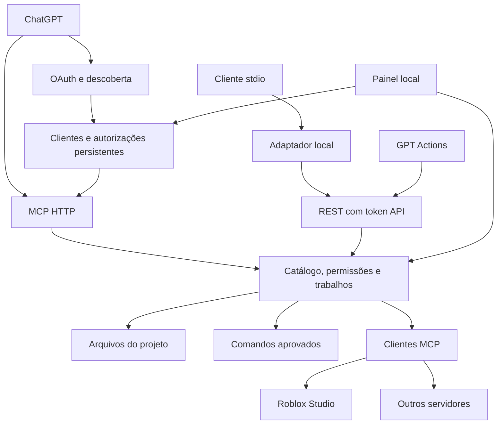

# Arquitetura da Ponte MCP 0.2.0

## Componentes

O mesmo processo mantém o provedor OAuth, os clientes externos e os trabalhos. As fachadas MCP e REST não executam ferramentas diretamente: ambas passam pelo `JobManager`. O consentimento OAuth autoriza uma conexão a solicitar ferramentas; a política de trabalhos determina quais solicitações exigem revisão local antes de executar.

## Decisões

**Servidor local com painel web.** Atende Windows sem depender de Electron ou empacotamento nativo. O pacote também é executável em Linux/macOS. O frontend não depende de serviços externos nem envia telemetria.

**Dois listeners.** Permite encaminhar ferramentas por HTTPS sem expor rotas administrativas. Tokens e origens também são verificados independentemente.

**OAuth na fachada MCP.** A API da porta 4318 contém descoberta, registro de clientes, autorização, consentimento no navegador, troca de tokens, renovação, revogação e `/mcp`. O painel da porta 4317 continua sendo o local onde o proprietário aprova a conexão. O servidor usa authorization code com PKCE `S256` e scope `ponte:tools`. Cada ferramenta declara sua política OAuth e o espelho compatível em `_meta.securitySchemes`.

**Compatibilidade com instalações existentes.** `/mcp` aceita access tokens OAuth e o token API legado. A REST `/v1/*` mantém a autenticação por token API, usada por Actions e pelo adaptador stdio. Tokens OAuth não autorizam rotas administrativas nem substituem a autenticação da REST.

**Transporte MCP sem estado de sessão.** Cada POST autenticado em `/mcp` recebe uma instância de servidor e transporte Streamable HTTP com resposta JSON. Não há sessão persistente do protocolo nem canal SSE mantido por GET; esse método retorna 405 depois da autenticação. O estado de autorizações e trabalhos pertence à aplicação, não à sessão de transporte.

**Trabalhos assíncronos.** Aprovação humana e comandos podem levar mais tempo que uma chamada de chat. A solicitação retorna um ID; o cliente consulta o resultado. As ferramentas MCP esperam brevemente leituras rápidas e devolvem o resultado diretamente quando pronto. Trabalhos pendentes não são falsamente representados como sucesso.

**SDK oficial e descoberta dinâmica.** Upstreams implementam protocolos e schemas diferentes. O hub usa o SDK MCP para negociação e transportes, pagina catálogos, cria nomes únicos e preserva blocos de conteúdo. Não assume os argumentos das ferramentas Roblox.

**SDK v1 fixado.** Esta versão utiliza `@modelcontextprotocol/sdk` 1.32.1 e o protocolo negociado por esse SDK. A decisão busca compatibilidade com o ecossistema stdio existente e as APIs documentadas utilizadas nos testes. A migração para a linha v2 deve ser uma mudança explícita de dependências e transportes, acompanhada de testes.

**API independente de provedor.** Nenhum SDK de modelo é necessário. O cliente de chat fornece o modelo e a política de conversação. O OpenAPI mantém somente cinco Actions e descobre schemas por catálogo, reduzindo a necessidade de reinstalar a integração a cada novo servidor conectado.

## Interfaces internas

`ToolDefinition` associa metadados MCP, risco, origem, fingerprint, preview opcional e execução cancelável. Ferramentas locais e externas implementam o mesmo contrato.

`ConfigStore` valida e persiste o estado administrativo. `JobManager` copia argumentos, valida JSON Schema, controla fila/aprovação/idempotência e registra transições. `McpHub` mantém clientes por conexão e descarta definições obsoletas. `Application` reúne esses componentes e compõe as rotas.

## Fluxo de autorização

1. O cliente descobre o recurso `/mcp` e o servidor de autorização. A origem HTTPS configurada fornece o `issuer` exato, sem barra final; o recurso acrescenta `/mcp`.
2. O ChatGPT cadastra um cliente em `/register` por DCR. O registro persiste e aceita `none` ou `client_secret_post`.
3. `/authorize` valida cliente, redirect, recurso, scope e desafio PKCE. A página `/oauth/consent` mostra um código de verificação de oito caracteres e acompanha o pedido.
4. O proprietário encontra o mesmo código no painel local e aprova ou rejeita. O navegador retorna ao redirect registrado com `state` e `iss`; no sucesso, recebe também um código OAuth de uso único.
5. O cliente troca o código em `/token`, comprovando PKCE e os vínculos da autorização. As credenciais emitidas ficam vinculadas ao cliente e ao recurso.
6. Chamadas MCP apresentam o access token. A validação de credenciais antecede a execução; em seguida, as permissões de projeto e as regras de aprovação de trabalhos continuam sendo aplicadas.
7. A renovação rotaciona o refresh token, preservando o prazo absoluto da autorização. Revogação e detecção de reutilização invalidam a família de tokens correspondente.

A implementação anuncia suporte à identificação do emissor em respostas de autorização (RFC 9207). Redirects de sucesso e erro incluem o `iss` exato. Erros anteriores à validação de cliente e redirect são respondidos diretamente, sem redirecionar para um endereço não validado.

## Persistência e limites de identidade

O diretório de estado padrão é `.ponte` dentro da pasta de instalação. `--state-dir` ou `PONTE_STATE_DIR` permitem reutilizar um caminho absoluto, inclusive ao mover ou atualizar o programa. `config.json` guarda a configuração; `secrets.json`, os tokens locais; `oauth.json`, clientes e autorizações OAuth. Trabalhos e resultados permanecem em memória, com auditoria de metadados e backups em disco.

Pedidos OAuth aguardam aprovação por 10 minutos. Códigos de autorização valem por 2 minutos, access tokens por até 1 hora e a autorização renovável tem prazo absoluto de 30 dias. A rotação do refresh token não reinicia esse prazo. O registro DCR e seu segredo não recebem expiração automática, para permitir sua reutilização após reinícios e novas autorizações. Pedidos pendentes e códigos ainda não trocados são voláteis; um reinício exige recomeçar esses fluxos.

A aplicação continua tendo **um único proprietário**. Conexões OAuth são revogáveis separadamente, mas compartilham o catálogo, os projetos autorizados e as políticas do painel. `ponte:tools` não cria uma divisão por projeto ou por usuário. Isolamento entre proprietários exigiria instâncias e diretórios de estado separados ou uma arquitetura de autorização adicional.

## Evoluções possíveis

As próximas etapas úteis dependem do uso real: perfis isolados por projeto, provedores externos de identidade, histórico completo com armazenamento cifrado, instalação como serviço, rollback pelo painel e suporte adicional a resources/prompts. Um isolamento real de comandos exige uma camada de sistema operacional separada. Esses itens não são apresentados como implementados nesta entrega.

O contrato do cliente ChatGPT está documentado nas páginas oficiais de [autenticação](https://developers.openai.com/plugins/build/auth) e [conexão de MCPs](https://developers.openai.com/api/docs/guides/custom-mcp-server). A validação local da implementação e a validação da conta do usuário são etapas distintas; os resultados da entrega ficam em [VALIDACAO.md](VALIDACAO.md).
