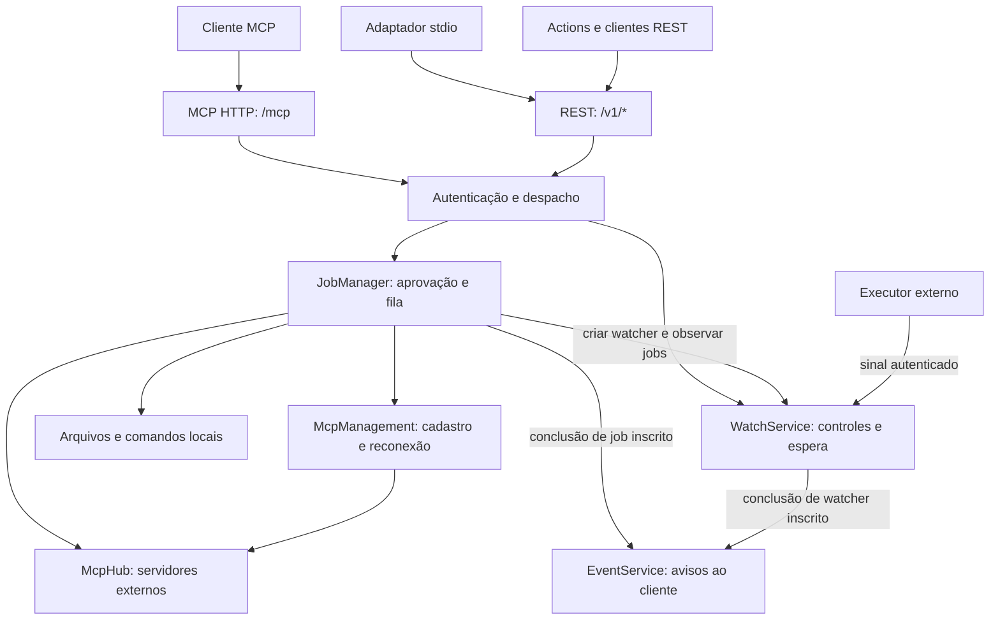

# Arquitetura da Ponte MCP 0.10.0

[Índice da documentação](README.md) · [Referência da API](API.md) · [Dots](DOTS.md) · [Segurança](SEGURANCA.md)

A Ponte é um serviço local de um único proprietário. Ela reúne ferramentas de arquivos, execução de comandos, servidores MCP externos, aprovação de trabalhos e acompanhamento durável de tarefas. O cliente de chat fornece o modelo e decide como conduzir a conversa; a Ponte não inclui um modelo nem altera cotas ou custos dos fornecedores.

## Componentes e caminhos de execução

A autenticação identifica a conexão antes do despacho. As ferramentas locais, as ferramentas de upstreams, `bridge_watch_create` e as três `bridge_mcp_*` passam pelo `JobManager`, inclusive quando chamadas por `bridge_read`, `bridge_invoke` ou `bridge_call`. Os controles `bridge_status`, `bridge_list_tools`, `bridge_tool_schema`, `bridge_job`, `bridge_cancel` e `bridge_watch_get/list/wait/cancel` têm caminhos próprios; consultar ou aguardar um watcher não cria um trabalho nem ocupa uma vaga de execução. Os métodos de protocolo `events/*` também são tratados diretamente pelo serviço de Events.

| Componente | Responsabilidade | Implementação |
|---|---|---|
| `Application` | Inicializar serviços, associar transições de jobs aos observadores e resolver a identidade API/OAuth | [src/app.ts](../src/app.ts) |
| `ConfigStore` | Validar projetos, servidores e política; persistir configuração e credenciais locais | [src/core/config.ts](../src/core/config.ts) |
| `PonteOAuthProvider` | Registro de clientes, consentimento, tokens e autorizações revogáveis | [src/auth/provider.ts](../src/auth/provider.ts) |
| Perfis de clientes | Gerar configurações Gemini/Grok, comandos locais e modelos de requisição das APIs | [src/clients/profiles.ts](../src/clients/profiles.ts) |
| `JobManager` | Validar argumentos, gerar prévia, aprovar, enfileirar, executar e cancelar ferramentas | [src/core/jobs.ts](../src/core/jobs.ts) |
| `McpManagement` | Listar conexões sem segredos, validar cadastro/reconexão e serializar alterações de upstreams pelo chat e painel | [src/mcp/management.ts](../src/mcp/management.ts) |
| `McpHub` | Manter clientes upstream, descobrir schemas e preservar os blocos de conteúdo retornados | [src/mcp/hub.ts](../src/mcp/hub.ts) |
| `WatchService` | Persistir acompanhamentos, receber sinais e manter esperas limitadas por proprietário | [src/watchers/service.ts](../src/watchers/service.ts) |
| `EventService` | Manter assinaturas, cópias de jobs, metadados de watchers e tentativas de entrega | [src/events/service.ts](../src/events/service.ts) |

`ToolDefinition` reúne schema MCP, risco (`read`, `write` ou `execute`), origem, fingerprint opcional, prévia e execução com `AbortSignal`. O `JobManager` usa a assinatura desses dados para detectar uma ferramenta ou configuração que mudou depois da solicitação. O contrato está em [src/types.ts](../src/types.ts).

## Interfaces e transportes

Existem dois listeners HTTP, ambos vinculados a `127.0.0.1`: administração na porta **4317** e API na **4318**, por padrão. A porta administrativa serve o painel e `/admin/*`; a API serve OAuth, MCP, REST, OpenAPI e os callbacks de watchers. As portas são configuráveis e precisam ser diferentes. Um encaminhamento HTTPS remoto deve publicar somente a API.

| Entrada | Autenticação | Uso |
|---|---|---|
| `/admin/*` | Token administrativo | Configuração, decisões locais e inspeção de todas as execuções |
| `/mcp` | Access token OAuth ou token API | Cliente MCP HTTP |
| `/v1/*` | Token API | Actions, clientes REST e adaptador stdio |
| `/hooks/watchers/:watcherId/signal` | Token exclusivo do watcher | Recibo do executor externo |
| `/openapi.json` e `/health` | Sem Bearer; sujeitos à validação de Host | Schema público e diagnóstico mínimo |

A fachada MCP usa **POST com respostas JSON, sem sessão persistente de transporte**. Para versões legadas, cada requisição cria servidor e transporte Streamable HTTP do SDK `@modelcontextprotocol/sdk` **1.32.1**. O protocolo `2026-07-28` usa o adaptador [src/mcp/modern.ts](../src/mcp/modern.ts), que valida envelope JSON-RPC, versão, capacidades e cabeçalhos correspondentes a cada requisição. GET autenticado em `/mcp` retorna 405; a fachada não mantém um canal SSE por GET.

O adaptador moderno anuncia `tools` e `events` e implementa `server/discover`, `tools/list`, `tools/call`, `events/list`, `events/subscribe` e `events/unsubscribe`. Os resultados modernos incluem `resultType: "complete"`. Resources, prompts, sampling e tarefas do protocolo não são anunciados. O adaptador stdio e os clientes upstream continuam no SDK v1; Events está disponível pela fachada HTTP moderna. A ausência de sessão HTTP não elimina o estado da aplicação em disco ou na memória.

O modo `stdio` é um adaptador do serviço já iniciado: lê o estado local, autentica-se com o token API e encaminha catálogo e chamadas para `/v1/mcp/tools` e `/v1/mcp/call`. Ele não inicia uma segunda instância independente da Ponte. A REST de Actions usa um OpenAPI com **nove operações**, cinco para status/catálogo/jobs e quatro para controles de watchers. A criação do watcher usa a operação existente `createJob`, com `tool: "bridge_watch_create"`; as três ferramentas `bridge_mcp_*` também usam `createJob`. Não há novas operações de administração no OpenAPI. Consulte [API.md](API.md) e [INTEGRACOES.md](INTEGRACOES.md).

## Perfis de clientes e exemplos de API

A v0.10.0 acrescenta uma camada de configuração em [src/clients/profiles.ts](../src/clients/profiles.ts), compartilhada pelo painel e pelo comando `export-client`. `createClientProfiles` recebe plataforma, caminhos absolutos de Node/CLI/estado e a origem pública opcional. Devolve seis perfis com formato, conteúdo, disponibilidade, motivo de indisponibilidade, documentação e comando opcional. Uma falha de representação afeta somente o perfil correspondente; não interrompe o estado do painel nem desabilita os demais.

O estado administrativo inclui os perfis em `connection.clientProfiles` e o comando local de obtenção do token em `connection.apiTokenCommand`. O gerador não lê valores de tokens, não grava configurações e não realiza chamadas de rede. Os perfis não são adicionados à resposta pública de estado do MCP. **Conectar IA** organiza esses caminhos nas abas ChatGPT, Claude, Gemini e Grok.

| Destino | Configuração gerada | Execução |
|---|---|---|
| Gemini CLI | JSON `mcpServers.ponte`; `command`/`args` ou `httpUrl`; timeout 60000 ms e `trust: false` | stdio local ou MCP HTTP com OAuth |
| Grok Build | TOML `[mcp_servers.ponte]`; `command`/`args` ou `url`; início 30 s e ferramenta 60 s | stdio local ou MCP HTTP com OAuth |
| Gemini API | Envelope JSON `{url, body}`; descritor `mcp_server` com `name`, `url`, `headers` e `allowed_tools` | Remote MCP a partir da Interactions API, com `store: false` |
| Grok API | Envelope JSON `{url, body}`; descritor `mcp` com `server_label`, `server_url`, `headers` e `allowed_tools` | Remote MCP a partir da Responses API |

Os apps Gemini/Grok não precisam desses arquivos: usam `/mcp` com descoberta OAuth, DCR e consentimento existente. Não foi criada uma rota de autenticação específica por fornecedor. Já os exemplos de API colocam o token **API** da Ponte em `Authorization` no descritor MCP, mesmo quando OAuth está ativo; a chave do modelo autentica separadamente a requisição ao provedor. O token administrativo não participa desse fluxo.

`buildApiRequest` constrói apenas URL fixa do provedor e corpo da requisição. Por padrão permite somente `bridge_status`; o modo `tools` permite as 12 ferramentas centrais, incluindo o gateway para os alvos autorizados. Os perfis exportados usam marcadores de modelo/token sem expansão automática. [gemini-api.mjs](../examples/gemini-api.mjs) e [grok-api.mjs](../examples/grok-api.mjs) leem o ambiente, fazem uma requisição com prazo de 120 segundos e não repetem operações automaticamente. Eles não implementam um processo permanente de acompanhamento; os contratos de jobs e watchers permanecem os mesmos.

As configurações e os comandos conservam os caminhos do estado selecionado, inclusive instalações personalizadas. JSON/TOML fazem o escape de seus próprios valores, e comandos citam argumentos literais para PowerShell ou shell POSIX. Como os clientes expandem variáveis depois de ler a configuração, padrões reconhecidos nesses caminhos tornam o perfil indisponível em vez de produzir uma referência a outro arquivo. A validação de URL exige HTTPS e recusa destinos literais locais/privados, credenciais e fragmentos; ela não faz DNS nem prova que o túnel está acessível.

`export-client` exige estado existente. Sem `--output`, escreve no stdout; com essa opção, cria exclusivamente um arquivo novo. O usuário mescla a entrada no cliente preservando as demais configurações. A opção `--url` afeta somente o export; não atualiza `publicUrl` nem configura o túnel. O comando curto de cadastro do Grok também não grava os prazos recomendados: esses campos vêm do TOML. Veja [Operação](OPERACAO.md#exportar-configurações-para-gemini-e-grok).

Os testes controlados verificam os perfis e o contrato do servidor. Eles não comprovam disponibilidade regional, login, ferramentas do modelo ou continuidade da conversa em uma conta do fornecedor. Os guias [Gemini](GEMINI.md) e [Grok](GROK.md) registram as fontes oficiais e os requisitos; a execução em contas reais dos novos clientes permanece não validada nesta entrega.

## Catálogo anunciado e execução pelo gateway

Desde a 0.9.0, `mcpToolExposure` separa a exposição inicial de descritores do catálogo real. O padrão `full` mantém as ferramentas individuais anunciadas. O perfil opcional `compact` anuncia oito ferramentas gerais (`bridge_status`, `bridge_list_tools`, `bridge_tool_schema`, `bridge_read`, `bridge_invoke`, `bridge_call`, `bridge_job`, `bridge_cancel`) e os quatro controles de watchers: **12 descritores**. A seleção fica em **Conectar IA → Catálogo MCP**, usa o `PATCH /admin/settings` existente e persiste em `config.json`.

O catálogo real continua reunindo as definições de `Application` e os controles de watchers. `bridge_list_tools` consulta esse catálogo nos dois perfis, com `includeSchemas: true` por padrão e opção de resumo sem schemas. `bridge_tool_schema` resolve o nome exato e devolve o descritor atual diretamente, acrescido da orientação `invocation`. O perfil não muda a resolução de nomes conhecidos, os limites de autorização ou as ferramentas permitidas do upstream. Uma chamada direta conhecida continua válida em `compact`.

`bridge_read` e `bridge_invoke` decodificam `argumentsJson` como objeto JSON e encaminham ao mesmo fluxo de despacho de `bridge_call`, que mantém `arguments` como objeto. A string JSON e o corpo HTTP continuam limitados a 1 MiB. Para alvos executáveis, o `JobManager` aplica o schema final, a política de aprovação, as permissões e a assinatura da definição. Os controles de watchers conservam seu caminho direto e validam seus próprios argumentos.

`bridge_read` exige risco `read` e preserva essa restrição durante a fila: a mudança de uma definição não autoriza escrita ou execução por uma solicitação de leitura. `bridge_invoke` tem anotações conservadoras porque encaminha também mutações e comandos; o risco real do alvo continua determinando o tratamento pelo `JobManager`. O resultado conserva o envelope MCP e seus blocos, inclusive imagens e dados estruturados, dentro dos limites existentes.

Não há uma API exclusiva para dots, uma configuração `defer_loading` ou um executor Work/Codex dentro desse caminho. `bridge_status.directExecution` declara execução em `ponte_host`, ausência de dependência dessas sessões e os controles do gateway. Também declara que a disponibilidade no cliente não é observável pelo servidor e que o cliente pode delegar. Essa separação importa porque a [documentação de dots](https://learn.chatgpt.com/docs/dots/computers-and-apps) condiciona plugins a conta, permissões e ambiente, e a [documentação de tarefas](https://learn.chatgpt.com/docs/dots/tasks-and-memory) permite outras threads. O guia [Dots](DOTS.md) define a verificação no cliente.

## Jobs: aprovação, execução e espera

Ao receber uma ferramenta do catálogo, o `JobManager` copia os argumentos, valida o JSON Schema, calcula a assinatura e, quando disponível, prepara a prévia. O trabalho recebe um `jobId` e um dos estados iniciais `pending_approval` ou `queued`.

| Política em `config.json` | Comportamento de ferramentas submetidas ao `JobManager` |
|---|---|
| `mutations` — padrão | Leituras podem executar; escritas e comandos aguardam revisão |
| `all` | Toda ferramenta submetida aguarda revisão, inclusive leituras |
| `automatic` | Libera solicitações válidas pendentes e novas submissões |

Essa política inclui `bridge_watch_create`, classificado como escrita, `bridge_mcp_list`, classificado como leitura, e `bridge_mcp_add/reconnect`, classificados como execução. Os controles de watcher consultam o serviço diretamente e continuam disponíveis sob `all`; cancelá-lo também não exige criar um job de aprovação. Todos exigem a identidade autorizada que possui o acompanhamento.

A assinatura é revalidada antes de aprovar e executar. A aprovação não suspende `allowWrite`, `allowExec`, listas de ferramentas permitidas, validação de argumentos ou `expectedHash`. Pedidos de aprovação expiram após **15 minutos**. O campo `approval` identifica liberações `manual` ou `automatic`; leituras permitidas por `mutations` podem não incluir esse campo.

Ao mudar para uma política mais restritiva, trabalhos automaticamente liberados ainda em `queued` retornam a `pending_approval` quando necessário. Aprovações manuais e trabalhos já iniciados são preservados. A pausa bloqueia novas submissões e a partida da fila; consultas, cancelamentos de acompanhamentos e sinais de watchers existentes continuam sendo processados. Revogar OAuth exige uma decisão separada da política de ferramentas.

A execução passa por `queued` e `running` até `succeeded`, `failed`, `rejected`, `cancelled` ou `expired`. Há até **quatro execuções simultâneas**, **200 jobs retidos**, limite de **4 MiB por resultado** e prazo máximo de **120 segundos por execução**. Antes de novas submissões, trabalhos terminais antigos podem ser removidos para acomodar o limite de quantidade ou reduzir a retenção acima de **64 MiB**. Esses limites não tornam uma chamada externa transacional: um timeout ou cancelamento pode acontecer depois de efeitos no destino.

A chamada MCP de uma ferramenta aguarda até **25 segundos** enquanto seu job está `queued` ou `running`; `pending_approval` inicial retorna imediatamente. `bridge_job` aceita `waitMs` de 0 a 25000, padrão 0, e pode aguardar também a aprovação. Ao vencer a espera, retorna o estado atual do mesmo job. A espera da chamada e o prazo da execução são independentes.

Jobs e suas chaves de idempotência ficam em memória. Reutilizar uma chave com os mesmos argumentos recupera o job enquanto ele estiver retido; argumentos diferentes são recusados. Reiniciar ou remover o job da retenção encerra essa garantia. Nenhuma operação externa é reenviada automaticamente após reconectar ou reiniciar.

## Gerenciamento de servidores MCP

`McpManagement` mantém um contrato restrito para o chat e operações administrativas para o painel. Suas definições têm origem `bridge:mcps` e entram no catálogo dinâmico de `Application`. A prévia de cadastro é somente uma representação dos argumentos validados; a configuração e o processo externo só são alterados durante a execução aprovada.

`bridge_mcp_add` normaliza a configuração com `enabled: true` e `readOnlyTools: []`. Não incorpora a lista inteira de servidores à assinatura da ferramenta: aprovar um cadastro independente não invalida outro apenas porque um servidor foi adicionado. Dentro da gravação, um ID ausente é incluído; configuração idêntica é reconhecida sem reiniciar; configuração diferente é conflito. O chat não altera projetos, política, permissões de leitura ou conexões existentes.

`bridge_mcp_list` projeta somente identificação, estado, quantidade de ferramentas e revisão, sem comandos, argumentos ou credenciais. A revisão é um HMAC da configuração normalizada com a chave da instância. `bridge_mcp_reconnect` exige a revisão esperada e a confere novamente na execução, impedindo iniciar uma configuração alterada depois da solicitação.

As operações de upstream do chat e as rotas administrativas de cadastro/edição, remoção, reconexão e preset Roblox compartilham uma fila. A fila serializa persistência e reconciliação com o hub, incluindo a tentativa de conexão. O serviço verifica autorização e `AbortSignal` antes do commit. Após persistir, conclui a reconciliação; uma falha de conexão mantém o cadastro e informa `registered: true` junto do status real e `isError: true`. Não restaura snapshots antigos sobre alterações concorrentes.

Uma conexão lenta pode consumir o prazo de jobs de gerenciamento que aguardam essa fila. O timeout máximo de 120 segundos do JobManager continua valendo; checagens antes da gravação impedem que um job já cancelado enquanto aguardava inicie seu cadastro posteriormente. O fechamento do serviço bloqueia novas mutações, aguarda a fila e só depois encerra definitivamente o hub.

O catálogo consulta `hub.tools()` a cada chamada. `bridge_list_tools` aceita filtro por `source`; `bridge_tool_schema` e os gateways resolvem a definição atual. Assim, um cliente com o `tools/list` inicial em cache ou com o perfil compacto pode cadastrar um servidor, consultar `source: "mcp:ID"` e usar seus nomes atuais na mesma conversa. A fachada HTTP permanece stateless; não anuncia notificações de catálogo por um canal persistente. O guia [MCPs pelo chat](MCPS-PELO-CHAT.md) detalha o uso e os limites.

## Watchers: acompanhamento nativo e durável

Um watcher persiste uma **observação**, enquanto um job representa a execução de uma ferramenta. A criação do watcher gera um job curto, sujeito à aprovação; quando ele termina, entrega um `watcherId`. Esse sucesso confirma que o acompanhamento foi criado. A tarefa externa só é confirmada pelo gatilho correspondente.

| Gatilho | O que observa | Comportamento no reinício |
|---|---|---|
| `signal` | POST autenticado do executor com `eventId`, `runId`, status e resumo | Continua aguardando até o sinal, o vencimento ou a perda da autorização |
| `job` | Estado terminal de um job já pertencente à mesma identidade | Recupera o estado disponível; se o job não puder ser encontrado, termina como `interrupted` |

Use `signal` para uma tarefa delegada a Claude, tmux ou outro executor. O fim de `send-keys` ou do comando que enviou a tarefa não comprova que ela terminou. Crie o watcher, obtenha a aprovação quando necessária, configure o callback no executor, delegue uma única vez e aguarde o mesmo `watcherId`. O procedimento não usa cron, automations ou agendadores do cliente. O guia completo está em [WATCHERS.md](WATCHERS.md).

O sinal permite `succeeded`, `failed` ou `needs_input`. A Ponte verifica o token específico, a autorização proprietária, o `runId` e o tamanho do JSON. Repetir o mesmo `eventId` com o mesmo conteúdo confirma o resultado já persistido; um sinal diferente depois de um estado terminal é recusado. `needs_input` também encerra esse acompanhamento e informa que a tarefa exige intervenção, sem significar conclusão bem-sucedida.

`bridge_watch_get/list/wait/cancel` usam o `WatchService` diretamente, inclusive quando encaminhados por `bridge_call`. A espera tem padrão de **25 segundos** e máximo de **45 segundos** no serviço e em todas as interfaces. Valores maiores são rejeitados com recuperação `get` pelo mesmo ID, sem ajuste silencioso. O prazo total usa `timeoutMs` na criação e `expiresAt`; uma nova espera não o estende. Uma desconexão encerra somente aquela chamada. Falhas de comunicação tratadas preservam o ID e orientam consulta, sem inventar estado. `bridge_watch_cancel` encerra a observação; não cancela o job original, não interrompe o executor e não desfaz seus efeitos.

Enquanto houver `waiting`, o chat mantém o turno ativo com esperas de 25000 ms pelo mesmo ID até terminal ou limite concreto do cliente. `needs_input` é terminal e exige apresentar a pendência ao usuário. `monitorDurable: true` e `canWakeClosedConversation: false` permanecem no contrato, independentemente da entrega HTTP de um evento.

`watchers.json` guarda estado, resultado limitado, vínculo de identidade, hash do token e recibo de deduplicação. A chave de idempotência do watcher persiste com o registro: chamar `bridge_watch_create` com a mesma identidade, chave e argumentos recupera o acompanhamento e sua credencial de sinal. Essa recuperação ainda passa pela política de criação. O token é derivado de um HMAC com o token API estável da instância; preservar somente `watchers.json` sem o `secrets.json` correspondente não é suficiente.

| Limite de watcher | Valor |
|---|---|
| Prazo total de acompanhamento | Padrão 1 hora; de 1 segundo a 7 dias |
| Acompanhamentos em `waiting` | 100 |
| Registros persistidos | 500; ao atingir capacidade, a próxima criação remove o terminal mais antigo |
| Esperas ativas | 200 no total e 20 por watcher |
| JSON de sinal/resultado | 32 KiB |
| Arquivo de estado | 24 MiB |
| Sinais autenticados | 60 por minuto, por watcher |

Registros terminais não são removidos somente porque `expiresAt` passou; a retenção é limitada por capacidade. A idempotência e a consulta deixam de existir quando o registro é removido. Revogar ou expirar a autorização cancela watchers que ainda aguardavam e impede acesso ou novos sinais nessa identidade. A rotina interna atualiza autorizações e prazos a cada 250 ms e também nas operações de controle. Fontes: [tipos e limites](../src/watchers/types.ts), [serviço](../src/watchers/service.ts), [ferramentas](../src/watchers/tools.ts) e [rotas HTTP](../src/http.ts).

## OAuth e propriedade dos registros

A origem HTTPS de `publicUrl`, sem barra final, define o emissor OAuth; o recurso é essa origem acrescida de `/mcp`. A Ponte implementa DCR, authorization code com PKCE `S256`, scope `ponte:tools`, renovação e revogação. O registro aceita `none` ou `client_secret_post`. As ferramentas anunciadas quando há origem pública incluem `securitySchemes` e seu espelho em `_meta.securitySchemes`.

O navegador recebe um código de verificação de oito caracteres. A decisão é tomada no painel administrativo local, nunca pela página pública de consentimento. Pedidos aguardam até **10 minutos**; códigos OAuth são de uso único e valem **2 minutos**. Access tokens valem até **1 hora**. Autorizações renováveis têm prazo absoluto de **30 dias**, preservado pela rotação do refresh token; clientes sem renovação recebem autorização de até **1 hora**. Clientes DCR persistem sem expiração automática de seu segredo. Pedidos pendentes e códigos ainda não trocados são voláteis.

A identidade de um cliente OAuth é o **grant**, a autorização individual concedida; renovar tokens preserva essa identidade. Um novo consentimento cria outra identidade. Clientes REST, stdio e MCP que usam o mesmo token API compartilham a identidade derivada desse token. Jobs, watchers e assinaturas de Events verificam esse vínculo. O administrador local tem acesso aos registros pelo painel. O catálogo, os projetos e as políticas continuam compartilhados entre conexões: não existe isolamento por projeto ou usuário.

A revogação pelo painel ou por `/revoke` remove a autorização inteira e seus tokens. Reutilizar um refresh token consumido também revoga a autorização. Mudar `publicUrl` invalida grants, tokens, pedidos pendentes e códigos vinculados ao emissor anterior; os cadastros de clientes permanecem. Essas ações impedem novos acessos e entregas autorizadas, mas não cancelam automaticamente todos os jobs já aceitos nem desfazem operações externas. As ferramentas de gerenciamento MCP revalidam a autorização antes de executar e persistir, além da autenticação da chamada inicial. Consulte [SEGURANCA.md](SEGURANCA.md) para limites e preservação de credenciais.

## MCP Events: notificações de saída

Events é um mecanismo separado do callback de entrada de um watcher. A implementação usa o [perfil de MCP Events da OpenAI](https://developers.openai.com/plugins/build/mcp-events) na fachada HTTP moderna. O cliente compatível precisa oferecer o recurso e criar a assinatura; o acompanhamento nativo descrito acima não depende dessa integração.

`ponte.job.completed` exige `arguments.jobId`; `ponte.watcher.completed` exige `arguments.watcherId`. Cada assinatura acompanha somente um registro da mesma identidade. O cliente fornece callback HTTPS e segredo `whsec_` em `events/subscribe`. A Ponte verifica o destino com desafio assinado antes de ativá-lo. Os eventos contêm metadados da conclusão; o cliente consulta `bridge_job` ou `bridge_watch_get` para obter o resultado. Uma assinatura posterior à conclusão recebe o estado terminal atual, sem histórico por cursor.

Assinaturas e tentativas de entrega persistem em `events.json`, junto de cópias dos jobs acompanhados, sem seus argumentos de entrada. Para jobs, a inscrição reserva espaço para o resultado final. Para watchers, Events guarda somente ID, status, horários e vínculo de retenção/proprietário; o resultado continua em `watchers.json`, sujeito à capacidade própria do serviço. A identidade do evento permanece estável nos reenvios, com no máximo **seis tentativas**; o destinatário deve deduplicar por `eventId`. HTTP 410/413 encerra a entrega; 2xx confirma o recebimento, sem comprovar continuidade ou sucesso de uma conversa.

Há até **100 assinaturas**, validade padrão e máxima de **24 horas por renovação** e orçamento de **64 MiB**, incluindo reservas. As cópias dos jobs persistem até a maior validade concedida para aquela combinação de identidade e job, mesmo após encerrar uma assinatura. Ao reiniciar, jobs arquivados que estavam incompletos e não existem no processo restaurado tornam-se `cancelled`; nenhuma ferramenta é repetida. Se um watcher `job` encontrar essa cópia recuperada, ele reflete seu estado `cancelled`, em vez de `interrupted`.

Uma assinatura do job de `bridge_watch_create` informa o fim da **criação do acompanhamento**. Para a tarefa externa, use o watcher `signal` e, quando houver suporte e inscrição do cliente, `ponte.watcher.completed`; depois do aviso, consulte `bridge_watch_get`. O fluxo de Events está em [MCP-EVENTS.md](MCP-EVENTS.md).

## Persistência e operação

O diretório padrão é `.ponte` na instalação, substituível por `--state-dir` ou `PONTE_STATE_DIR`. Cada arquivo tem uma função distinta:

| Estado | Persistência | Consequência operacional |
|---|---|---|
| `config.json` | Projetos, upstreams, portas, origem, política de aprovação e perfil do catálogo MCP | Reutilizar mantém a configuração; `mcpToolExposure` exige cuidado ao voltar para uma versão anterior |
| `secrets.json` | Tokens administrativo/API; token API também é a chave dos sinais | Preservar junto do estado de watchers |
| `oauth.json` | Clientes, grants e hashes de tokens | Reutilizar mantém conexões OAuth ainda válidas |
| `watchers.json` | Acompanhamentos e resultados limitados | Sobrevive à chamada e ao reinício; não reinicia executores |
| `events.json` | Assinaturas, entregas, segredos de webhook, cópias de jobs e metadados de watchers | Recupera avisos; resultados de jobs seguem retenção e identidade, e resultados de watchers permanecem em `watchers.json` |
| `audit.jsonl` e backups | Metadados de transições e conteúdos anteriores de arquivos editados | Não equivalem a uma fila de execução recuperável |
| Fila e jobs comuns | Memória | Perdidos no reinício, salvo as cópias limitadas de Events |

As gravações de watchers, OAuth e Events usam arquivos privados e substituição do estado. Watchers e Events também sincronizam o arquivo temporário antes da substituição. Esses dados não recebem cifragem em repouso pela Ponte. Preserve o diretório completo ao atualizar, e consulte [OPERACAO.md](OPERACAO.md) para instalação, backups e diagnóstico.

O projeto não implementa isolamento de comandos pelo sistema operacional, recuperação automática da execução de jobs, separação de projetos por usuário nem migração completa para o SDK MCP v2. Os testes e a integração efetivamente observada estão registrados em [VALIDACAO.md](VALIDACAO.md).
